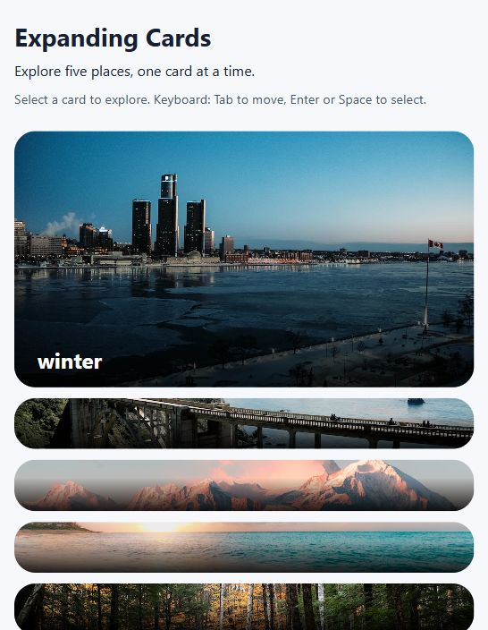

# Expanding Cards

An interactive travel photo gallery built with HTML, CSS, and vanilla JavaScript. Select a photo card to expand it and reveal its caption.

## Preview



The layout switches to horizontal cards on wider screens.

## Features

- Five travel photo cards with one selected at a time.
- Horizontal cards on wider screens; vertical cards at widths of 600px or less.
- All five cards remain available on mobile.
- Native buttons support mouse, touch, Tab, Enter, and Space.
- Visible keyboard focus and selection state exposed through `aria-pressed`.
- White captions over a dark gradient for improved readability.
- Respects the device's `prefers-reduced-motion` setting.
- No package installation, build step, API key, or backend required.

## Run locally

1. Download this repository using **Code → Download ZIP**, then extract it. Alternatively:

   ```sh
   git clone https://github.com/Shariatypour/Expanding-Cards.git
   cd Expanding-Cards
   ```

2. Open `index.html` in your browser. Keep the `css`, `js`, and `assets` folders beside it so styles, scripts, and images load correctly.
3. Optionally, open the folder in VS Code and serve `index.html` with the Live Server extension.

The default branch, `main`, contains the current version of the project.

## Controls

| Input | Action |
| --- | --- |
| Click or tap | Select and expand a card |
| Tab / Shift + Tab | Move focus between cards |
| Enter / Space | Select the focused card |

Moving keyboard focus does not change the selected card until it is activated.

## Project structure

```text
Expanding-Cards/
├── index.html          # Page structure and accessible card buttons
├── css/style.css       # Layout, captions, focus, and motion preferences
├── js/script.js        # Card selection and aria-pressed synchronization
└── assets/img/         # Five gallery photos
```

## How it works

The `.active` class gives the selected card more space in the flex layout and reveals its caption. JavaScript updates that class and `aria-pressed` together so the visible selection and accessibility state agree.

On smaller screens, `flex-direction: column` changes expansion from horizontal to vertical. The same selection handler works for both layouts.

## Manual checks

- Select each card and confirm that only one stays expanded.
- Use Tab and Shift + Tab to check visible focus, then select with Enter and Space.
- At 390px width, check that all five cards can be selected without horizontal scrolling.
- At 1280px width, check that the cards form a horizontal row.
- Enable reduced motion in your device settings and confirm that selection changes without transitions.

## Publish with GitHub Pages

After the reviewed changes have been merged into `main`:

1. Open the repository's **Settings → Pages**.
2. Under **Build and deployment → Source**, choose **Deploy from a branch**.
3. Select **main** and **/(root)**, then save.
4. Wait for deployment to complete and open the site URL shown by GitHub Pages.
5. Test the live site's images, styles, card selection, and keyboard controls before adding its URL to this README.

See [GitHub's publishing-source documentation](https://docs.github.com/en/pages/getting-started-with-github-pages/configuring-a-publishing-source-for-your-github-pages-site).

## Project status

This learning project demonstrates responsive layouts, DOM events, and accessible card selection. See [pull request #1](https://github.com/Shariatypour/Expanding-Cards/pull/1) for the implementation history. A public live demo has not been set up yet.
